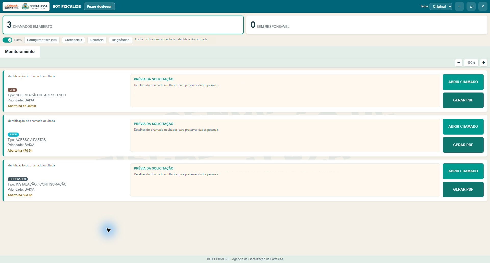

# BOT Fiscalize

Projeto de apoio ao monitoramento de chamados e à geração de relatórios, desenvolvido por **Caio Klisman** com apoio do Codex.



Captura feita no aplicativo Windows instalado e em funcionamento. Identificações, conta institucional e conteúdo dos chamados foram cobertos para preservar dados pessoais. A interface, os indicadores e os controles são os do aplicativo real. O código deste repositório continua sendo a amostra isolada descrita abaixo.

[Veja a galeria com as principais telas reais](docs/GALERIA.md)

## Escopo desta publicação

Este repositório contém uma **amostra executável do módulo real de captura de conteúdo** usado no projeto desktop e no contexto móvel. A demonstração usa um chamado fictício e funciona localmente, sem credenciais nem acesso ao sistema institucional.

Não é o aplicativo completo e não contém o monitor operacional, servidor, configurações internas, contas ou bancos de chamados reais.

## O que a amostra demonstra

- Localização da seção de descrição de um chamado no DOM.
- Captura de descrição, histórico e tabelas com preservação da estrutura.
- Remoção de elementos interativos e scripts do conteúdo capturado.
- Tratamento de sessão expirada e falha ao carregar conteúdo.
- Rotinas de espera e incorporação de imagens para apoiar a impressão no produto completo.

A página de exemplo mostra uma prévia em iframe isolado. A geração nativa de PDF pertence ao aplicativo completo e não integra esta amostra.

## Executar

Requisito: **Node.js 24 ou superior**. Não há dependências para instalar.

```sh
git clone https://github.com/CKlisman/bot-fiscalize.git
cd bot-fiscalize
npm test
npm start
```

Abra o endereço local exibido no terminal e clique em **Capturar conteúdo**. Confira a descrição, o histórico e a tabela na prévia. Nenhum chamado real é acessado ou modificado.

## Projeto completo

A solução possui aplicação Windows e versão Android em evolução, com monitoramento periódico, notificações, consulta de detalhes, histórico local e relatórios. A execução em segundo plano no Android depende das permissões e restrições do sistema.

**Tecnologias do projeto completo:** JavaScript, Node.js, Electron, SQLite, TypeScript, React Native e WebView. **Nesta amostra:** JavaScript, APIs do DOM e Node.js para prévia e testes.

## Organização

| Caminho | Conteúdo |
| --- | --- |
| `src/ticket-content.cjs` | Módulo original de captura, sem alteração das regras |
| `demo/ticket-content.cjs` | Cópia idêntica carregada na demonstração |
| `demo/index.html` | Chamado fictício e prévia isolada |
| `demo/demo.js` | Adaptador de demonstração |
| `tests/` | Integridade das cópias, exportação do módulo e sessão expirada |
| `docs/SOURCE_SHA256.txt` | Integridade do módulo publicado |

## Decisões e aprendizados

A extração de conteúdo foi isolada em um módulo reutilizável entre contextos. A rotina interrompe a captura quando não consegue carregar imagens, evitando produzir um relatório silenciosamente incompleto. A publicação demonstra essa parte sem expor integrações institucionais.

**Validação local em 03/11/2026:** três testes de Node aprovados. Eles não equivalem à validação de todas as integrações do produto completo. O GitHub Actions repete os testes; consulte a aba Actions para os resultados remotos.

[Portfólio de Caio Klisman](https://github.com/CKlisman) · [Escopo da publicação](docs/ESCOPO.md)
