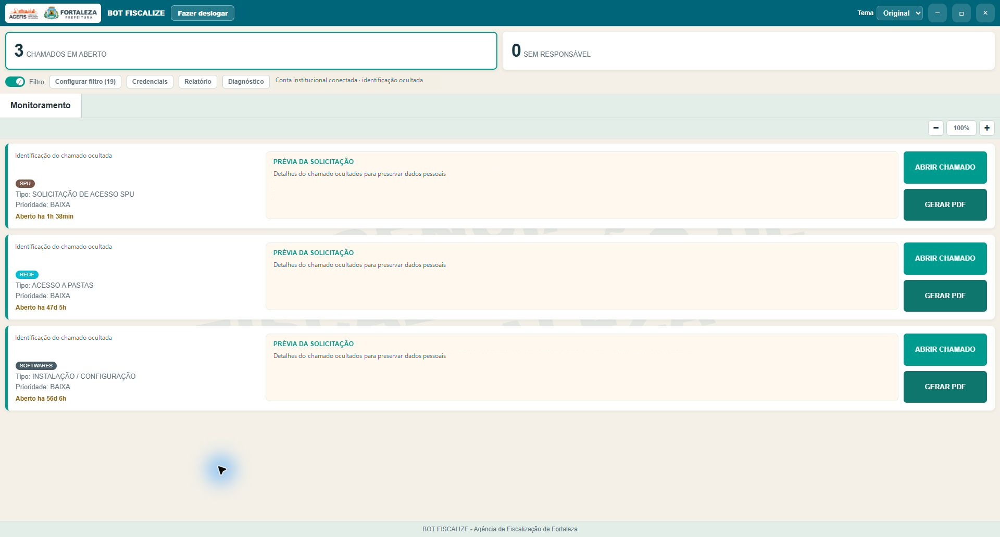
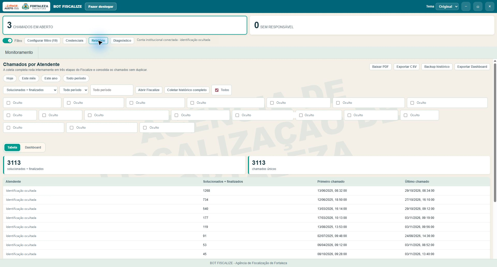
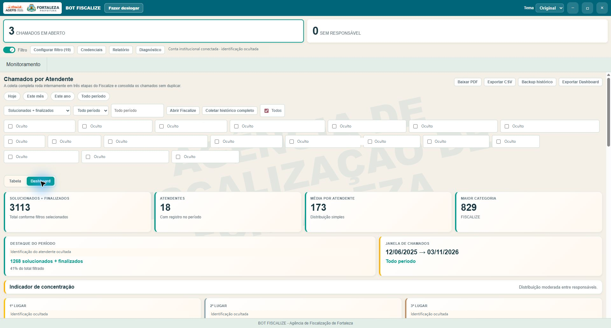
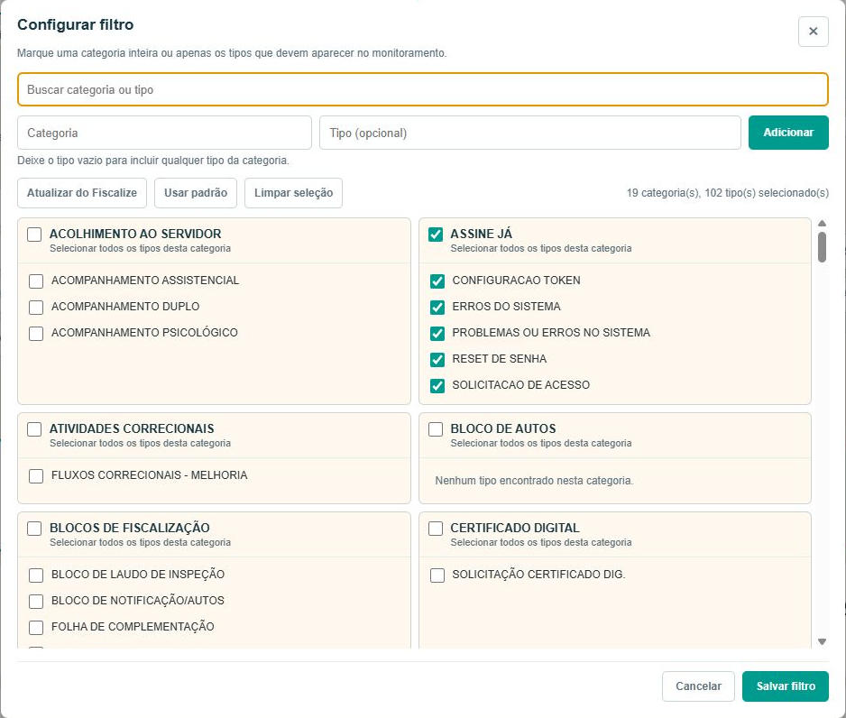

# Telas reais do BOT Fiscalize

Capturas feitas no aplicativo Windows instalado e em funcionamento em 03/11/2026. A interface e os valores são os do aplicativo real. Nomes, conta institucional e detalhes dos chamados foram ocultados; a configuração de filtros foi recortada para excluir dados pessoais do fundo. Nenhum chamado foi alterado.

## Monitoramento de chamados — aplicativo real

## Relatório em tabela — aplicativo real

## Dashboard de relatórios — aplicativo real

## Configuração de filtros — recorte do painel real

